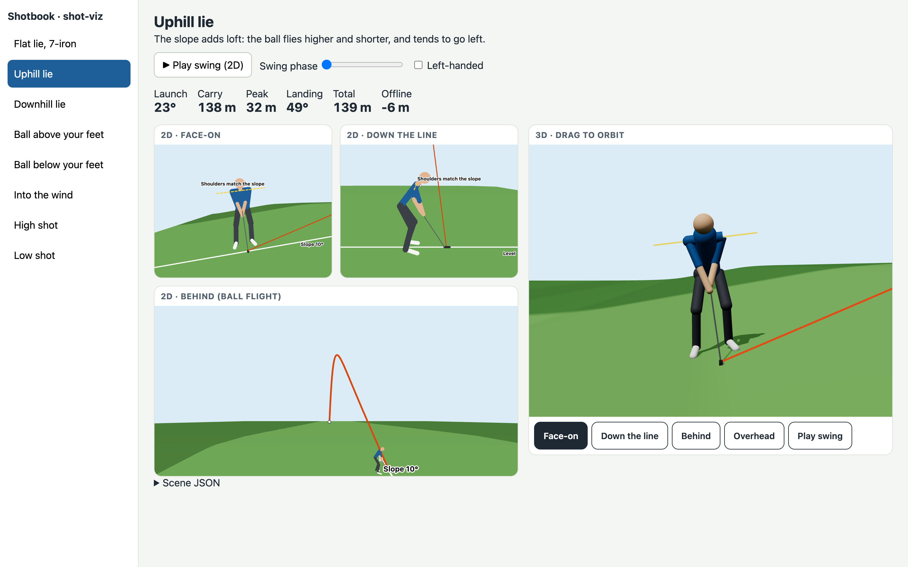

# @shotbook/shot-viz

Shot visualisations for Shotbook. A situation can point to a **ShotScene**: a small JSON
description of the lie, the golfer's setup, the swing and the ball flight. Renderers draw it in 2D
(SVG) or 3D (three.js).



## Entry points

| Import                     | What                                                          | Runs on              |
| -------------------------- | ------------------------------------------------------------- | -------------------- |
| `@shotbook/shot-viz`       | Types, zod schema, maths, example scenes, 2D scene → shapes   | Anywhere (no DOM)    |
| `@shotbook/shot-viz/web`   | `<ShotDiagram>` (React DOM SVG) and `LazyShotScene3D`         | Web                  |
| `@shotbook/shot-viz/three` | `<ShotScene3D>` (react-three-fiber), the heavy part           | Web (WebGL)          |

The core must stay platform-neutral so the native app can import it. three.js, r3f and drei are
optional peer dependencies, only needed for `/three`.

```tsx
import { exampleScenes } from "@shotbook/shot-viz";
import { LazyShotScene3D, ShotDiagram } from "@shotbook/shot-viz/web";

<ShotDiagram scene={exampleScenes["downhill-lie"]} view="face-on" />
<Suspense fallback={null}>
  <LazyShotScene3D scene={exampleScenes["downhill-lie"]} />
</Suspense>
```

`ShotDiagram` is plain SVG: it renders on the server (Astro) and needs no JavaScript or WebGL. It
is one `role="img"` with a `<title>` and a generated plain-language `<desc>` (`describeScene`).
`ShotScene3D` is about 1 MB of JavaScript (260 kB gzipped), so it loads only when shown, and it
does not autoplay when the reader prefers reduced motion. Its camera buttons are real buttons
with 44 px touch targets.

## Scene format

Scenes are data, not code. Only `id` and `title` are required; everything else has a default or
is derived from the slope. See [`src/core/schema.ts`](src/core/schema.ts) for the full contract and
[`src/scenes/`](src/scenes) for examples.

```json
{
  "id": "ball-above-feet",
  "title": "Ball above your feet",
  "terrain": { "slopeAlong": 0, "slopeAcross": 10, "lie": "fairway", "firmness": "normal" },
  "golfer": { "handedness": "right", "aim": 4 },
  "swing": { "club": "7-iron", "length": "three-quarter", "path": 0, "face": 0 },
  "flight": { "trajectory": "normal", "wind": { "speed": 5, "from": 90 } },
  "annotations": [{ "type": "aim-line", "label": "Aim a little right" }],
  "camera": "down-the-line"
}
```

Conventions:

- Units: metres, seconds, degrees, m/s (5 m/s ≈ 11 mph).
- `slopeAlong` > 0 is uphill toward the target. `slopeAcross` > 0 is ball above the feet.
- Left and right are written **for a right-handed golfer**. `"handedness": "left"` draws the mirror
  image, so the same numbers work for both. This matches the content rule "state it for
  right-handers and add (left-handers: mirror this)".
- Wind `from`: 0 = into your face, 90 = from the right, 180 = from behind.
- Golfer fields `weightLead`, `shoulderTilt`, `ballPosition` and `gripDown` are derived from the
  slope and club when omitted (`deriveSetup`). Explicit values always win.
- Cameras: `face-on`, `down-the-line` (frame the golfer), `behind`, `overhead` (frame the flight).
- Annotations: `target-line`, `aim-line`, `shoulder-line`, `slope-line`, `ball-flight`, `arrow`.

## The maths (pure TypeScript, tested)

World frame: ball at the origin, `x` toward the target, `y` up, `z` to the right. A right-hander
stands at negative `z`. This is three.js's frame, so 3D uses it directly.

- **Terrain** (`terrain.ts`): the lie's slope holds for 4 m around the ball, then eases out to
  level ground, like a terrace. So the landing area of an uphill shot sits higher.
- **Setup** (`setup.ts`): mainstream slope adjustments. Shoulders follow the slope, the ball moves
  toward the higher foot, weight favours the lower foot uphill and the lead foot downhill. With the
  ball above the feet the golfer stands taller and grips down; with it below, they flex more.
- **Launch** (`setup.ts`): club defaults (speed, launch, spin) adjusted for trajectory, swing
  length, lie and slope. Uphill adds loft and pulls left, downhill delofts and pushes right, and
  the ball above the feet points the face left.
- **Flight** (`flight.ts`): gravity, drag, spin lift with a tilted spin axis for curve, and wind.
  It then bounces and rolls with simple friction, which depends on landing angle, spin and ground
  firmness. The numbers are plausible (7-iron about 143 m carry, driver about 210 m), not
  launch-monitor accurate.
- **Pose** (`pose.ts`): a stylised 17-joint mannequin. Legs and arms use two-bone IK. The golfer
  stands where the club reaches the ball, and the swing is a hub-and-plane model with keyframes
  from address through top and impact to finish. `timeline.ts` maps time to swing phase and ball
  time with a 3:1 tempo, so 2D and 3D share one clock.
- **Cameras** (`camera.ts`): the presets and a pinhole projector. 2D uses the same cameras as 3D.

```
pnpm test        # vitest: schema, geometry, flight, slope adjustments, 2D shapes
pnpm typecheck
pnpm build       # library to dist/
pnpm dev         # standalone demo at http://localhost:5173 (2D and 3D side by side)
pnpm build:demo  # static demo in dist-demo/
```

Until the workspace root lands, run these inside this folder with
`pnpm install --ignore-workspace`.

## Native app (step 7)

- **2D:** `buildShapes2D(scene, options)` returns a flat list of polygons, polylines, circles and
  text in screen coordinates, with no DOM types. `ShotDiagram.tsx` maps them to `<svg>` elements
  in about 60 lines. A `@shotbook/shot-viz/native` entry would do the same with `react-native-svg`
  (`Polygon`, `Polyline`, `Circle`, `Text`; arrowheads come from `arrowHead()`, not SVG markers).
- **3D:** two options. `@react-three/fiber/native` with `expo-gl` can reuse most of
  `ShotScene3D`, but `Html` labels, the toolbar and OrbitControls need native replacements (for
  example drei/native controls with RN buttons). Or embed the web 3D view in a `WebView`: fastest to
  ship, but heavier. Try r3f native first and keep WebView as the fallback.
- Scene JSON is bundled with the app content; the core maths runs unchanged in Hermes.

## Next: a rigged, animated golfer (step 6)

The mannequin is posed procedurally from `poseGolfer(scene, phase)`. To move to a realistic
golfer:

1. Make or license a rigged, low-poly golfer in glTF/GLB (Draco or meshopt compressed, ideally
   under 1 MB). Use a Mixamo-style humanoid skeleton and animation clips for address, swing and
   finish. Ask the owner before adding assets from an external source or a CDN.
2. Keep `ShotScene` as the input. Map the derived setup (stance width, ball position, spine and
   shoulder tilt, knee flex, weight) onto the rig as additive bone offsets on top of the clips.
3. Drive the clip time from `timelineAt()` so ball launch stays in sync with impact. Expose a
   scrubber (address → top → impact → finish).
4. Keep the procedural mannequin as the fallback for low-end devices and for tests. The joint
   names in `JOINTS` can double as the retargeting map.
